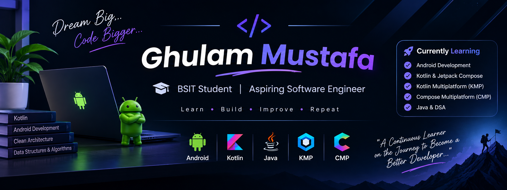

  

 

 

# 👋 Hi, I'm Ghulam Mustafa

### BSIT Student | Aspiring Software Engineer

**Passionate about Mobile Development, AI-Powered Applications & Software Engineering.**

---

## 🚀 About Me

I'm a Bachelor of Science in Information Technology (BSIT) student passionate about software development, mobile technologies, artificial intelligence, and building meaningful solutions to real-world problems.

I enjoy learning new technologies, exploring different areas of software engineering, and improving my skills through practical projects.

## 🎯 My Goals

- Become a skilled Software Engineer.
- Build modern and user-friendly mobile applications.
- Develop intelligent applications using AI integration.
- Explore cross-platform development.
- Develop strong programming and problem-solving skills.
- Learn backend engineering and software architecture.
- Build scalable and maintainable software solutions.

## 💻 Technologies & Tools

### 👨‍💻 Programming Languages

### 📱 Mobile Development

### ⚙️ Backend & Database

### 🤖 AI & Intelligent Applications

- AI Integration in Mobile Applications
- Generative AI & LLM APIs
- AI-Powered Features
- Intelligent Chatbots & Assistants
- Retrieval-Augmented Generation (RAG)

### 🛠️ Development Tools

## 📚 Currently Learning

- Android Development
- Kotlin & Jetpack Compose
- Kotlin Multiplatform (KMP)
- Compose Multiplatform (CMP)
- Java Programming
- Object-Oriented Programming (OOP)

## 🌱 Future Interests

- AI Integration & Intelligent Applications
- Generative AI and LLMs
- iOS Development with Swift
- Java Backend Development with Spring Boot
- Advanced Backend Engineering
- Software Architecture & Design Patterns
- Cloud Computing
- System Design

## 🧠 What I Believe In

- Learn something new every day.
- Build projects through practical experience.
- Write clean and maintainable code.
- Stay curious and explore new technologies.
- Improve consistently as a Software Engineer.

## 🤝 Connect With Me

---

### 💡 My Developer Philosophy

# Learn. Build. Improve. Repeat. 🚀

*Always learning, always building, always improving.*

